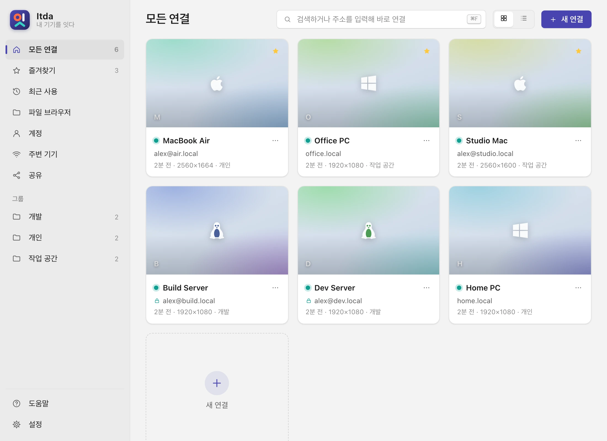
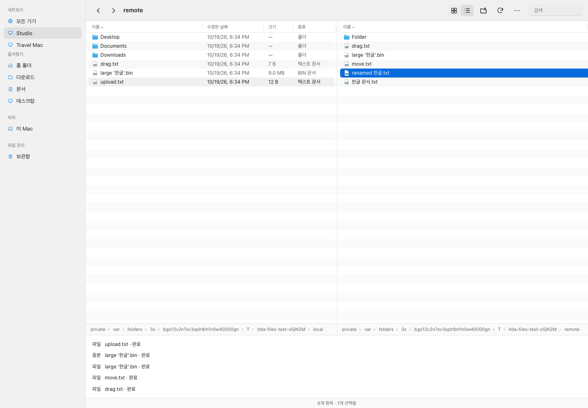
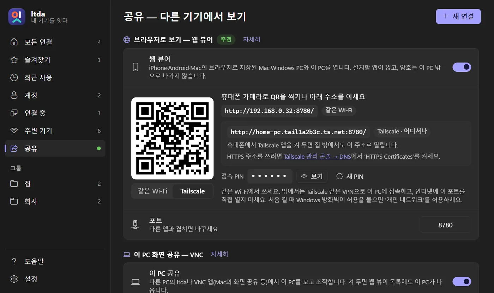
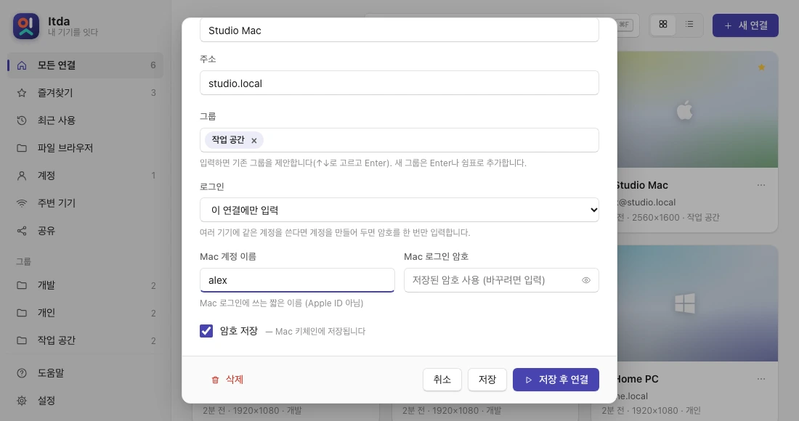
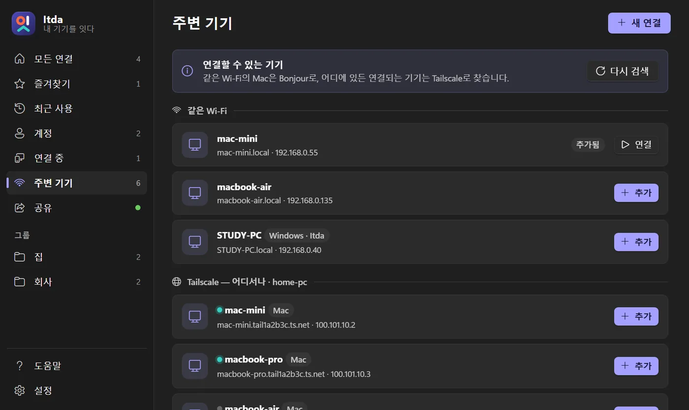
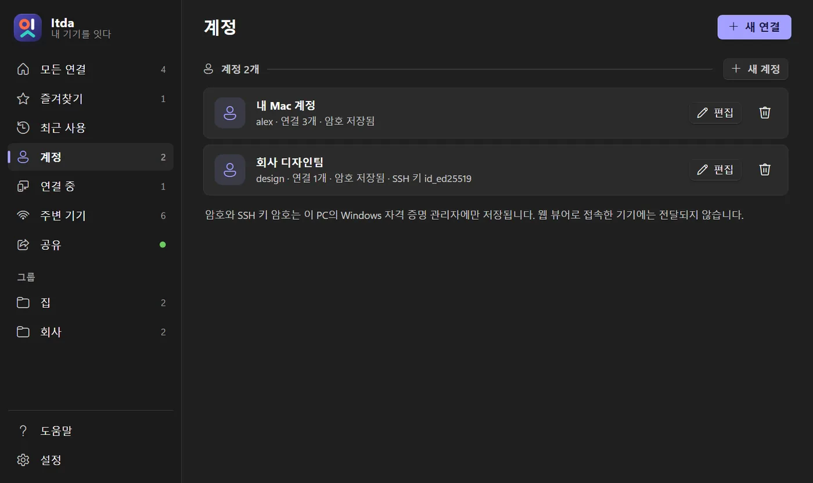
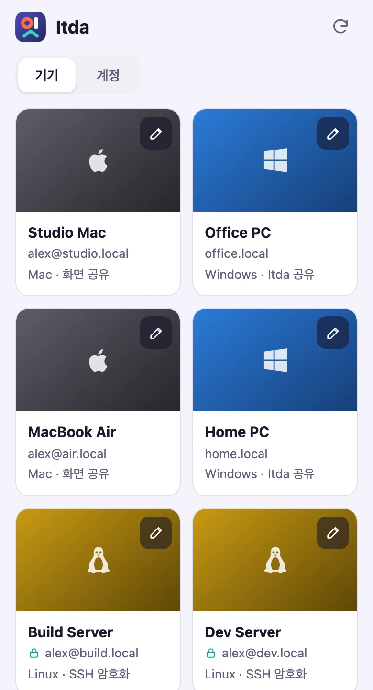
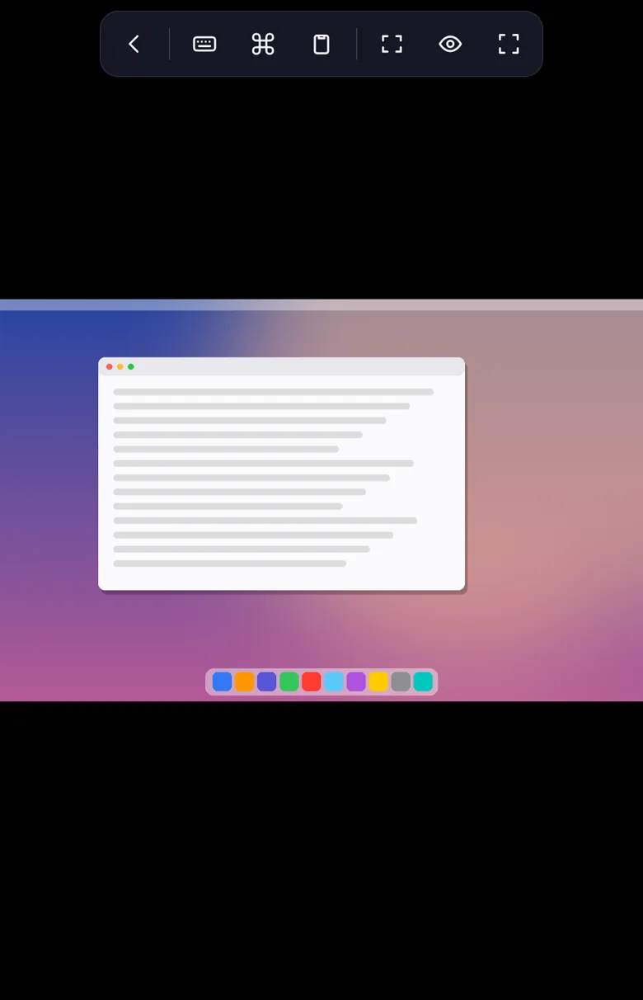
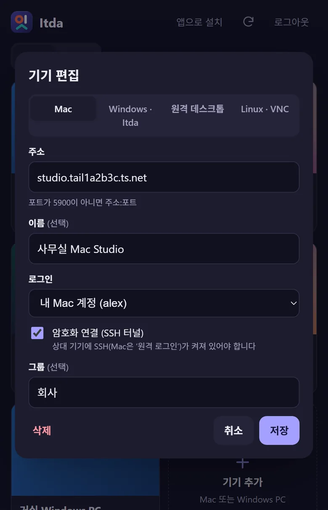
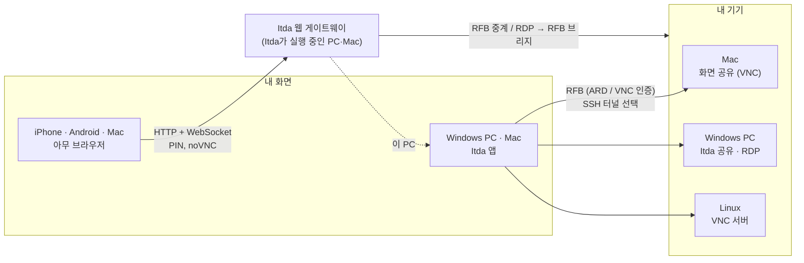

<div align="center">


# Itda · 잇다

**내 기기를 잇다.** · Your devices, within reach.

**Mac**, **Windows PC**, **Linux**를 여는 작고 빠른 원격 데스크톱입니다. iPhone과 Mac을 포함한 **모든 브라우저**에서도 내 기기들을 볼 수 있습니다.

[](https://github.com/jiunbae/itda/releases/latest)
[](https://github.com/jiunbae/itda/actions/workflows/ci.yml)
[](LICENSE)


[**다운로드**](https://github.com/jiunbae/itda/releases/latest) · [웹사이트](https://jiun.dev/itda/) · [시작하기](https://jiun.dev/itda/start.html) · [보안](SECURITY.md) · [English](README.md)



</div>

---

## ✨ Itda를 쓰는 이유

|  |  |
|---|---|
| ⚡ **가볍고 빠릅니다** | 설치 없이 실행하는 6 MB짜리 exe 하나입니다. 원격 화면은 Win32 렌더러가 직접 그리고(ZRLE, 바뀐 부분만 다시 그리기, 모니터별 DPI), 연결마다 별도 프로세스에서 돌아갑니다. |
| 🍎 **macOS 화면 공유에 맞췄습니다** | Apple ARD 로그인(DH + AES), Mac 단축키(⌘Space, ⌘Tab, Mission Control…), 한/영 키, 여러 모니터, 양방향 클립보드를 지원합니다. |
| 🪟 **Windows PC도 엽니다** | **이 PC 공유**를 켜면 어떤 Windows든 ‘허용할까요?’를 묻는 VNC 서버가 됩니다. **원격 데스크톱**은 PC에서는 `mstsc`로, 브라우저와 Mac 앱에서는 내장 RDP 브리지로 열고, 해상도가 창 크기를 따라갑니다. |
| 🌐 **브라우저가 곧 뷰어** | 웹 뷰어를 켜고 QR 코드를 찍으면 iPhone, Android, Mac, Linux에서 앱 설치 없이 내 기기와 *이 PC*를 엽니다. 앱처럼 설치할 수도 있습니다(PWA). |
| 🔒 **암호는 밖으로 나가지 않습니다** | 암호는 Windows 자격 증명 관리자(Mac은 키체인)에만 저장되고 브라우저로 전달되지 않습니다. **SSH 터널** 암호화, 잠금이 걸리는 PIN 로그인, 출처 확인을 지원합니다. |
| 🛰️ **Tailscale로 어디서나** | tailnet의 기기가 자동으로 나타나고, 웹 뷰어에 `https://…ts.net` 주소가 생깁니다. 포트 포워딩이 필요 없습니다. |
| 👤 **계정** | 로그인 정보를 한 번 저장해 여러 기기에 씁니다. 암호를 한 번만 바꾸면 그 계정을 쓰는 모든 기기에 적용됩니다. |
| 🧭 **친절합니다** | 첫 실행 안내, 스크린샷이 있는 사용 시나리오별 도움말, 무엇을 해야 하는지 알려 주는 오류 안내가 있습니다. |

## 🍏 Mac용 Itda

[릴리스](https://github.com/jiunbae/itda/releases/latest)에서 `Itda-macos-universal.zip`을 받으세요. macOS 12 이상, Apple 실리콘과 Intel 모두에서 실행됩니다.

1. 압축을 풀고 **Itda.app**을 응용 프로그램 폴더로 옮깁니다.
2. 아직 공증을 받지 않은 앱입니다. 처음 열 때 ‘Apple이 확인할 수 없습니다’가 뜨면 **완료**를 누르고, **시스템 설정 → 개인정보 보호 및 보안** 아래쪽의 **그래도 열기**를 누릅니다. macOS 14 이하에서는 **오른쪽 클릭 → 열기 → 열기**로 실행합니다.
3. **기기 추가:** **주변 기기**(Bonjour와 Tailscale)에서 고르거나 주소를 직접 입력합니다.

Windows판과 같은 홈을 Mac에 맞는 말로 보여 줍니다. 미리보기가 있는 주소록, 주변 기기, 계정, 휴대폰용 웹 뷰어(QR + PIN), 도움말, 설정이 모두 있습니다.
- **열 수 있는 기기:** 다른 Mac(화면 공유, SSH 터널 선택), **Itda 공유**나 **원격 데스크톱**을 켠 Windows PC(Itda가 RDP를 직접 처리), Linux/VNC 서버입니다. 연결마다 창이 하나씩 열리고, 원격 화면 크기에 맞춰지며, 끊기면 스스로 다시 연결하고 클립보드를 주고받습니다. 원격 데스크톱은 해상도가 창 크기를 따라갑니다.
- **기기와 계정:** 암호는 로그인 **키체인**에, 데이터는 `~/Library/Application Support/Itda`에 저장됩니다.
- **이 Mac 공유하기:** macOS에 들어 있는 화면 공유를 씁니다. Itda의 공유 페이지에서 그 설정을 바로 열고, 다른 기기에서 넣을 주소와 계정 이름을 보여 줍니다.

내부적으로 각 연결 창은 `127.0.0.1`의 전용 게이트웨이에 붙은 웹 뷰어(noVNC)이고, 실행할 때마다 새로 만든 토큰으로 로그인합니다.

## 🚀 빠른 시작

1. [릴리스](https://github.com/jiunbae/itda/releases/latest)에서 `itda.exe`를 **받아 실행**합니다. WebView2는 Windows 11에 기본으로 들어 있고, Windows 10에서 없다면 [WebView2 런타임](https://go.microsoft.com/fwlink/p/?LinkId=2124703)을 설치하세요.
2. **연결할 기기를 준비합니다**
   - **Mac:** 시스템 설정 → 일반 → 공유 → **화면 공유** 켜기.
   - **Windows:** Itda → **공유** → **이 PC 공유**를 켜거나, Pro 에디션이라면 원격 데스크톱을 켭니다.
   - **Linux:** 아무 VNC 서버나 실행합니다.
3. **연결합니다.** 첫 실행 안내가 차례로 알려 주고, 같은 네트워크의 기기는 저절로 나타납니다.
4. **휴대폰이나 Mac 브라우저에서:** **공유** → **모두 켜기** → QR 코드 찍기 → PIN 입력.

## 📁 화면과 별도로 파일 열기

주소록 상단의 **파일**은 네트워크 창을 엽니다. 저장된 기기·주변 Itda·Tailscale 기기를 함께 보고 파일과 화면을 각각 열 수 있습니다. 사이드바에는 저장된 기기와 파일 창 열림 표시가 나타납니다. 기기마다 별도의 창으로 열립니다. **화면 연결됨**과 **파일 창 열림**은 서로 다른 상태입니다.

macOS의 **Finder 연결 폴더**는 저장된 기기의 `.inetloc` 바로가기를 `…/Itda/Locations/Itda`에 만들고 Finder에서 엽니다. 바로가기는 `itda://files/<기기 ID>`로 해당 기기의 파일 창을 열며 암호·SSH 키·원격 경로를 포함하지 않습니다. 이 폴더를 Finder 사이드바에 추가할 수 있습니다. 실제 원격 볼륨이나 File Provider는 아니며, SSH 원격 파일을 Finder 안에서 직접 탐색·편집하는 기능은 아직 제공하지 않습니다. Finder 버튼으로 여는 SMB 공유폴더는 실제 운영체제 파일 연결입니다. CLI로는 `Itda.app/Contents/MacOS/itda --export-file-locations`를 사용할 수 있습니다.

주소록 카드나 목록의 **파일 열기**는 기기별 독립 창을 엽니다. 같은 기기를 다시 누르면 기존 창을 앞으로 가져옵니다. 화면 공유와 별도로 사용하며, 창을 닫아도 진행 중인 전송은 계속됩니다. 다시 열 때 살아 있는 연결은 재사용합니다.



_격리된 SSH 테스트 환경의 파일 창입니다._

macOS 파일 창은 단일 도구 모음, 너비를 조절할 수 있는 사이드바, 하단 경로 막대와 이름·수정한 날짜·크기·종류 열을 제공합니다. 목록의 열 너비도 조절할 수 있습니다. ⌘1/⌘2는 아이콘/목록 보기, ⌘[/⌘]는 뒤로/앞으로, ⌘⇧G는 폴더로 이동, ⌘⇧.은 숨김 파일 표시입니다. 동작 팝업에서 분할 보기·전송 내역·연결 설정에 접근합니다.

기기의 저장 계정을 기본으로 사용하고, 파일용으로 다른 저장 계정을 선택해도 화면 연결 계정은 바뀌지 않습니다. 연결 방법·주소·포트는 접힌 **연결 설정**에서 변경합니다. 자동 모드는 지정된 공유폴더가 있으면 Finder/탐색기를 열고, 그 외에는 SFTP를 시도합니다. SSH를 사용할 수 없고 SMB 서비스가 확인되는 경우 운영체제 파일 관리자로 이어집니다. 인증 실패는 계정 수정을 안내합니다. SMB 로그인은 운영체제에서 관리하므로 별도 확인이 필요할 수 있습니다.

- **원격 로그인 · SSH**: Mac의 원격 로그인, Linux/OpenSSH, Windows OpenSSH 서버에 SFTP로 연결합니다. 저장한 계정과 SSH 키를 사용할 수 있고 파일용 암호는 별도로 키체인/자격 증명 관리자에 저장합니다.
- **공유폴더 · Finder/탐색기**: `smb://기기/공유폴더` 또는 `\\기기\공유폴더`를 실제 운영체제 파일 관리자로 엽니다. 상대 기기에서 파일 공유와 접근 권한을 설정해야 합니다. LAN과 Tailscale 주소를 사용할 수 있습니다.
- SFTP 파일 창은 macOS/Windows에 맞춘 도구 모음·사이드바와 목록/아이콘 보기, 검색, 정렬, 다중 선택, 뒤로/앞으로/상위 폴더, 새 폴더, 이름 변경을 제공합니다. 분할 보기에서는 내 기기와 원격 기기 사이를 드래그하거나 복사/잘라내기/붙여넣기할 수 있습니다. Finder/탐색기에서 파일을 창으로 끌어넣는 전송도 같은 큐를 사용합니다.
- 이름 충돌은 **둘 다 유지 / 변경된 파일 바꾸기 / 건너뛰기** 중 선택합니다. 바꾸기 모드는 크기와 수정 시각으로 동일 파일을 건너뜁니다. 원격 수정 시각은 SFTP v3의 초 단위 정밀도이므로 같은 크기·같은 시각으로 변경한 내용까지 검증하는 동기화로 간주하지 마세요.
- 새 파일은 임시 이름으로 쓴 뒤 공개합니다. 장치 간 **이동**은 SHA-256을 비교하고 원본의 크기·수정 시각을 재확인한 후 원본을 삭제합니다. 같은 파일시스템 내 이동은 이름 변경을 우선합니다. 전송은 취소할 수 있으며 취소한 항목의 기존 대상과 원본을 보존합니다.
- **보관함으로 이동**은 운영체제 휴지통 대신 각 파일 연결의 `.itda-trash`에 보관합니다. 이름 변경과 보관함 이동은 되돌리기 버튼 또는 ⌘/Ctrl+Z로 복원할 수 있습니다. 원격 파일 열기는 로컬 **보기 전용 사본**이며 원격에 자동 저장하지 않습니다.

**증분 전송:** 자동 모드는 폴더 또는 8MiB 이상 파일을 ‘바꾸기’로 복사할 때 로컬/상대편 rsync와 호환 SSH 셸을 확인해 변경된 파일·블록만 전송합니다. 지원하지 않으면 SFTP로 복사합니다. rsync는 설치되어 있어야 하며 Windows 로컬 rsync는 함께 제공되는 `cygpath.exe`가 있는 호환 배포판만 자동 감지합니다. ‘일반 전송’은 rsync를 실행하지 않습니다. rsync 중단 파일은 `.itda-partial`로 남겨 다음 전송에 재사용합니다. SFTP 전송의 블록 증분과 중단 지점 재개는 아직 제공하지 않습니다.

탐색용 SSH와 전송용 SSH는 분리되어 대용량 복사 중에도 탐색할 수 있습니다. 동시에 실행하는 전송은 두 개, 파일당 미응답 SFTP 요청은 최대 64개(32KiB씩)로 제한합니다. 영구 삭제·삭제를 전파하는 미러 동기화·심볼릭 링크 따라가기는 기본 작업에 포함하지 않습니다. 일반 SFTP 복사는 심볼릭 링크를 만나면 원본을 유지하고 오류를 표시합니다. 열/갤러리 보기·훑어보기·목록에서 폴더 펼치기, rclone/WebDAV, Itda 간 자체 공유 서버, SFTP 파일을 Finder/탐색기로 끌어내는 가상 파일 제공, ACL/확장 속성 전체 보존은 후속 범위입니다. 모든 Finder/탐색기 기능을 대체하는 것으로 표시하지 않습니다.

## 🖼️ 스크린샷

| 공유 페이지: 웹 뷰어 QR, PIN, 이 PC | 연결 편집 (Mac / Windows / RDP / Linux) |
|---|---|
|  |  |
| **주변 기기** (Bonjour + Tailscale) | **계정**: 로그인 하나를 여러 기기에 |
|  |  |

<p align="center">



</p>

## 🧩 동작 방식



브라우저는 암호를 받지 않습니다. PC(또는 Mac)의 Itda가 각 기기에 로그인하고, 화면과 입력만 중계합니다.

## 📖 사용 안내

<details>
<summary><b>주소록, 연결, 접속 창</b></summary>

| 화면 | 내용 |
|---|---|
| 주소록 | 카드 또는 목록, 마지막 화면 미리보기, 응답 여부 ●, 즐겨찾기 ★, 그룹, 검색. 주소를 입력하고 Enter를 누르면 바로 연결합니다. |
| 주변 기기 | Bonjour(mDNS)로 화면 공유가 켜진 Mac과 Itda가 실행 중인 모든 PC·Mac을 찾습니다. 공유가 꺼져 있어도 나타나고, 켜는 방법을 알려 줍니다. 30초마다 새로 찾고, Tailscale 기기도 함께 보여 줍니다. 한 번 눌러 추가합니다. |
| 연결 중 | 단계(주소 → 연결 → 로그인 → 화면)를 보여 줍니다. 취소하거나 뒤에서 계속 진행하게 둘 수 있습니다. |
| 오류 | 원인과 해결 방법을 기기 종류(Mac, PC, RDP, Linux)에 맞는 말로 설명합니다. |
| 설정 | 테마, **화면 크기(Ctrl +/−, Ctrl+휠; Mac은 ⌘)**, 툴바 방식, 단축키, 새 연결 기본값, 알림 영역, 알림, 미리보기. |

**접속 창 툴바** (Windows, 위쪽 가운데, 자동 숨김): 전체 화면, 맞춤 또는 1:1, 모니터 선택, Mac 특수 키, 클립보드, 보기 전용, 스크린샷(`사진\Itda`), 통계, 고정, 연결 끊기.

**단축키** (Ctrl+Alt 또는 Ctrl+Shift): `Enter` 전체 화면 · `0` 맞춤 · `1` 1:1 · `S` 통계 · `V` 보기 전용 · `P` 스크린샷 · `I` 정보 · `T` 툴바 고정 · `R` 재연결 · `M` 메뉴.

**키 대응:**

| Windows | Mac |
|---|---|
| Win | ⌘ Command (창이 앞에 있을 때 가로챔) |
| Alt | ⌥ Option |
| Ctrl | ⌃ Control (Ctrl↔Cmd 바꾸기를 켜면 ⌘) |
| 한/영 | Ctrl+Space 또는 Caps Lock |

네트워크가 끊기면 화면이 어두워지고 **자동으로 다시 연결**합니다. 접속 중에 바꾼 옵션은 그 연결에 저장됩니다.

**명령줄:**
- `itda <주소>`: 홈을 열고 연결합니다.
- `itda <주소> -u <사용자> -p <암호>`: 바로 연결합니다.
</details>

<details>
<summary><b>웹 뷰어: 휴대폰, 태블릿, Mac</b></summary>

왼쪽의 **공유** → **웹 뷰어**(또는 **모두 켜기**)를 엽니다. 아무 기기에서 주소를 열거나 QR 코드를 찍고 **6자리 PIN**을 넣습니다.

- **열 수 있는 것:**
  - Mac과 그 밖의 VNC 서버
  - 원격 데스크톱을 켠 Windows PC (PC의 Itda가 RDP를 처리)
  - **이 PC** ("이 PC 공유"가 켜져 있을 때). PIN으로 이미 확인했으므로 허용을 묻지 않습니다.
- **브라우저에서 관리:** 기기 추가·편집·삭제와 계정 관리. 바뀐 내용은 PC에 바로 저장됩니다.
- **터치:**
  - 탭 = 클릭, 두 손가락 탭 = 오른쪽 클릭, 끌기 = 스크롤
  - 휴대폰 키보드 (한글 입력 가능)
  - 보조 키 잠금: Mac은 ⌘⌥⌃⇧, PC는 Ctrl/Alt/⇧/⊞
  - 단축키 모음: Mac, 또는 Windows (Ctrl+Alt+Del, Alt+Tab, …)
  - 클립보드, 맞춤/1:1, 보기 전용
- **앱처럼 설치:**
  - iPhone: Safari → 공유 → **홈 화면에 추가**
  - Mac: Safari → **파일 → Dock에 추가**
  - Chrome/Edge/Android: **앱 설치**. Tailscale의 `https://…ts.net` 주소가 필요합니다.
- **보안:**
  - 12시간짜리 HttpOnly 쿠키
  - PIN을 5번 틀리면 1분 동안 로그인이 막힘
  - 출처(same-origin) 확인
  - 새 PIN을 만들면 모두 로그아웃
  - 브라우저 ↔ PC 구간은 일반 HTTP입니다. 내 Wi-Fi나 Tailscale에서만 쓰고 **인터넷에 포트를 열지 마세요**.
</details>

<details>
<summary><b>암호화(SSH), Tailscale, 계정</b></summary>

**SSH 터널.** 연결 편집에서 *SSH로 암호화해서 연결*을 켭니다. Mac의 **원격 로그인**(또는 아무 SSH 서버)이 필요합니다.
- Itda가 Windows에 들어 있는 OpenSSH(Mac은 `/usr/bin/ssh`)를 창 없이 실행해 `127.0.0.1:<임의 포트> → 기기:5900`을 전달합니다.
- 암호는 `SSH_ASKPASS`로 Itda가 넘겨주고, `~/.ssh`의 키와 설정도 그대로 쓸 수 있습니다.
- 호스트 키는 Itda 데이터 폴더의 `known_hosts`에 고정됩니다. 키가 바뀌면 경고와 함께 연결을 멈춥니다.
- 네트워크가 끊겼다 돌아오면 터널을 스스로 다시 엽니다.

**Tailscale.** tailnet의 Mac, PC, Linux가 *주변 기기 → Tailscale*에 나타납니다. 웹 뷰어는 `http://<pc>.<tailnet>.ts.net:8780/` QR 코드를 보여 줍니다. Tailscale 관리 화면에서 HTTPS 인증서를 켜고 *HTTPS 주소 만들기*를 누르면 `tailscale serve`로 `https://<pc>.<tailnet>.ts.net/` 주소가 생깁니다.

**계정.** 로그인 정보(이름, 암호, 선택으로 SSH 키와 키 암호)를 한 번 저장하고 기기마다 고릅니다. 같은 사용자 이름을 쓰는 기기가 여럿이면 Itda가 한 계정으로 묶자고 제안합니다.
</details>

<details>
<summary><b>Windows PC: 이 PC 공유와 원격 데스크톱</b></summary>

| 방법 | 지원 | 방법 |
|---|---|---|
| **이 PC 공유** | Itda를 실행한 모든 Windows 10/11 | 그 PC에서 **공유 → 이 PC 공유**. 주변 기기에 "Windows · Itda"로 나타나고, 공유 암호로 연결합니다. macOS 화면 공유와 다른 VNC 앱도 연결할 수 있습니다. |
| **원격 데스크톱** | Windows Pro / Enterprise / Education | 편집기에서 *Windows 원격 데스크톱*을 고릅니다. Windows의 Itda는 계정을 `mstsc`에 넘겨 열고, Mac의 Itda와 웹 뷰어는 Itda가 직접 연결(IronRDP: TLS + NLA)해 화면을 보여 줍니다. |

**이 PC 공유의 동작:**
- 모든 모니터를 GDI로 캡처, 64×64 타일 비교, ZRLE
- 마우스·키보드는 SendInput; Mac의 ⌘은 Ctrl로 동작
- 양방향 클립보드
- 무작위 VNC 암호와 연결마다 ‘허용할까요?’ 묻기 (기본으로 켜짐). 같은 네트워크와 내 Tailscale 기기는 암호만으로 바로 연결
- 누가 보고 있는 동안 알림과 알림 영역 표시, 모두 끊기 버튼
- 보기 전용 모드와 Bonjour 등록

Windows 보안 정책상 잠금 화면, UAC 창, 관리자 권한 창은 원격으로 조작할 수 없습니다.
</details>

<details>
<summary><b>내 데이터</b></summary>

| 위치 | 내용 |
|---|---|
| `%APPDATA%\Itda\hosts.json`, `accounts.json`, `settings.json` (Mac: `~/Library/Application Support/Itda/`) | 주소록, 계정, 설정 |
| `…\Itda\thumbs\` | 마지막 화면의 작은 미리보기 (끌 수 있음) |
| Windows 자격 증명 관리자 `Itda/…` (Mac: 로그인 키체인의 `Itda` 항목) | 암호, 키 암호, 웹 PIN, 공유 암호 |
| `%TEMP%\itda.log`, `%TEMP%\itda\session-*.log` | 진단 로그 (암호는 기록하지 않음) |
</details>

## 🛠️ 소스에서 빌드

```powershell
cargo build --release      # → target\release\itda.exe
cargo test --release
```

Mac에서는 `scripts/macos-bundle.sh universal`로 `dist/Itda-macos-universal.zip`을 만듭니다. 배포용 Windows exe는 `scripts/windows-release.ps1`로 빌드합니다. 두 스크립트 모두 빌드한 컴퓨터의 경로를 바이너리에 남기지 않습니다.

파일 기능 검증은 `cargo test files::`로 실행합니다. macOS에서는 `cargo build` 후 Playwright가 설치된 환경에서 `node scripts/files-e2e.mjs`로 임시 SSH 서버를 사용하는 UI·전송 통합 테스트도 실행할 수 있습니다. 시스템 SSH 설정과 실제 사용자 파일은 변경하지 않습니다.

<details>
<summary><b>프로젝트 구성</b></summary>

| 파일 | 역할 |
|---|---|
| `home.rs` · `home_win.rs` · `home_mac.rs` | 홈 창과 페이지 IPC, 세션, 응답 확인. 플랫폼별: WebView2 + 알림 영역 + 세션 프로세스(Windows), WKWebView + 메뉴 막대 + 뷰어 창(macOS) |
| `web/` | 홈 UI (HTML/CSS/JS, 바이너리에 포함; `ITDA_WEB_DIR`로 디스크에서 제공 가능) |
| `session.rs` · `ui.rs` · `toolbar.rs` | 세션 프로세스와 창: 그리기, 입력, 툴바, 재연결, 스크린샷 |
| `rfb.rs` · `net.rs` · `fb.rs` · `clip.rs` | RFB 핸드셰이크/인증, 수신 루프와 재연결, 디코더, 클립보드 |
| `tunnel.rs` | OpenSSH를 쓰는 SSH 터널 |
| `gateway.rs` · `ws.rs` · `web/viewer/` | 웹 뷰어: HTTP/WebSocket, PIN, 주소록 API, RFB 중계, PWA |
| `rdp.rs` | RDP → RFB 브리지 (IronRDP, TLS + NLA → 프레임버퍼 → ZRLE) |
| `share.rs` | 이 PC 공유: VNC 서버 (GDI 캡처, 타일 비교, ZRLE, SendInput, Bonjour) |
| `enc.rs` | RFB 픽셀 형식과 Raw/ZRLE 사각형 (`share.rs`와 `rdp.rs`가 함께 씀) |
| `web/icons.js` · `scripts/macos-bundle.sh` | Mac용 Itda: Segoe Fluent 글리프 대신 선 아이콘, `.app` 번들 |
| `store.rs` · `mdns.rs` · `tailscale.rs` | 저장소와 자격 증명, Bonjour, Tailscale CLI |

| 영역 | 구현 |
|---|---|
| 프로토콜 | RFB 3.8 (macOS 3.889). 인증: None, VNC (DES), Apple ARD (DH + AES-128) |
| 인코딩 | ZRLE, CopyRect, Raw, 그리고 Cursor, DesktopSize, ExtendedDesktopSize, Extended Clipboard |
| 지연 시간 | TCP_NODELAY, 파이프라인 업데이트 요청, 로컬 커서, 응답 확인 |
| 그리기 | DIB 섹션, 바뀐 영역만 blit, 1:1은 `BitBlt` / 축소는 `StretchBlt(HALFTONE)`, 모니터별 DPI v2 |

테스트용 환경 변수 `ITDA_TEST_HTTP`, `ITDA_TEST_SNAP`, `ITDA_DEBUG_PORT`는 설정하지 않으면 아무 일도 하지 않습니다.
</details>

## 🗺️ 앞으로

- [ ] VPN 없이 기기에 닿는 중계 서버
- [x] Mac 앱 (Mac용 Itda)
- [ ] Linux 앱 (지금은 웹 뷰어를 쓰세요)
- [ ] 브라우저 RDP: 클립보드, 소리, 드라이브, RD 게이트웨이
- [ ] 서명된 설치 프로그램과 자동 업데이트

## 🤝 기여와 보안

이슈와 PR을 환영합니다. [CONTRIBUTING.md](CONTRIBUTING.md)를 보세요. 보안 취약점은 [SECURITY.md](SECURITY.md)에 적힌 방법으로 비공개로 알려 주세요.

## 📜 라이선스와 감사

[MIT](LICENSE) © 2026 Jiun Bae.

Itda는 다음을 바탕으로 만들었습니다:
- [noVNC](https://github.com/novnc/noVNC) 1.7.0 (MPL-2.0, `web/viewer/novnc.min.js`에 포함, ZRLE 디코더만 더 빠른 것으로 교체; `web/viewer/NOVNC.md` 참고)
- [IronRDP](https://github.com/Devolutions/IronRDP) (MIT/Apache-2.0)와 [rustls](https://github.com/rustls/rustls)
- [wry](https://github.com/tauri-apps/wry)와 `Cargo.toml`의 Rust 크레이트들

<sub>아이콘은 ‘잇’의 글자를 그립니다. ㅇ은 내 기기, ㅣ는 연결, ㅅ은 다른 기기로 건너가는 다리입니다. 획마다 Itda가 잇는 플랫폼의 색을 입혔습니다.</sub>
