<div align="center">


# Itda · 잇다

**Your devices, within reach.** · 내 기기를 잇다.

Connect to your devices’ **screens and files** from **Windows and Mac**. Browse remote files in a separate window, or open saved devices from a browser on your phone or tablet.

[](https://github.com/jiunbae/itda/releases/latest) [](https://github.com/jiunbae/itda/actions/workflows/ci.yml) [](LICENSE)   

[**Download**](https://github.com/jiunbae/itda/releases/latest) · [Website](https://jiun.dev/itda/) · [Getting started](https://jiun.dev/itda/start.html) · [Security](SECURITY.md) · [한국어](README.ko.md)

<picture>
  <source media="(prefers-color-scheme: dark)" srcset="docs/img/home-window-dark.png">
  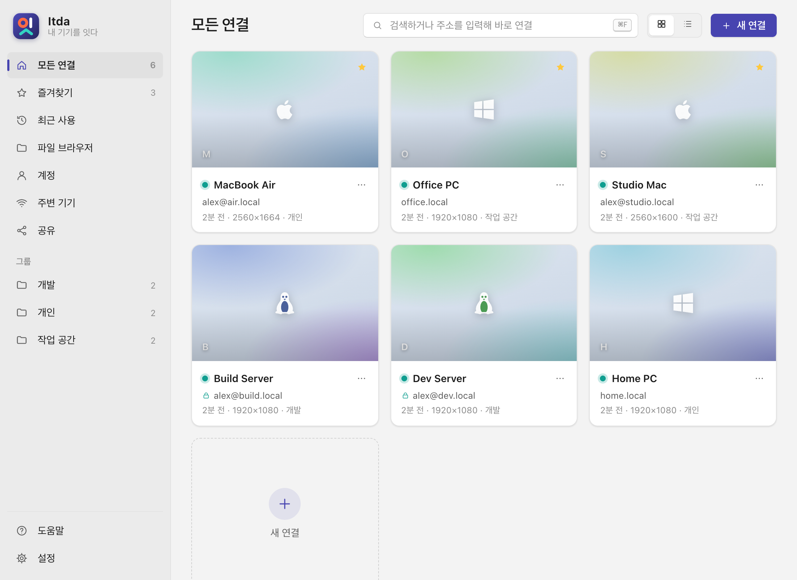
</picture>

</div>

---

## ✨ Why Itda

|  |  |
|---|---|
| ⚡ **Native and fast** | A Windows executable and a universal Mac app for Apple silicon and Intel. Local cursors and changed-region updates reduce screen traffic; each remote screen opens in its own window. |
| 🍎 **Made for macOS Screen Sharing** | Apple ARD sign-in (DH + AES), Mac shortcuts (⌘Space, ⌘Tab, Mission Control…), Korean/English key, multi-display, and the clipboard in both directions. |
| 🪟 **Windows PCs too** | **Share this PC** turns any Windows into a VNC server with an "allow?" prompt. **Remote Desktop** opens in `mstsc` here, and in the browser and the Mac app through the built-in RDP bridge, whose resolution follows your window. |
| 🌐 **Any browser is a client** | Turn on the web viewer and scan a QR code. iPhone, Android, Mac and Linux open your devices *and this PC*, with no app to install. You can also install it as an app (PWA). |
| 🔒 **Private by design** | Passwords stay in Windows Credential Manager or the macOS Keychain and never reach the browser. Optional **SSH tunnel** encryption, PIN sign-in with lockout, and same-origin checks. |
| 🛰️ **Anywhere with Tailscale** | Tailnet devices show up automatically, and the web viewer gets a `https://…ts.net` address. No port forwarding. |
| 📁 **Files in their own window** | Reuse saved accounts over SSH/SFTP, with tabs, previews, copy/move and delta copies through rsync when available. Mac and Windows have their own file-browser layouts. |
| 👤 **Accounts** | Save one login and use it on many devices. Change the password once, and every device that uses it is updated. |
| 🧭 **Friendly** | A first-run guide, a help center with screenshots, and errors that say what to do in plain Korean. |

## 🍏 Itda for Mac

Download `Itda-macos-universal.zip` from [Releases](https://github.com/jiunbae/itda/releases/latest). It runs on macOS 12+, on Apple silicon and Intel.

1. Unzip it and move **Itda.app** to Applications.
2. Open **Itda.app**. Official Mac releases are Developer ID signed and notarized by Apple.
3. **Add a device:** pick one from **주변 기기** (Bonjour and Tailscale), or type an address.

It is the same home as on Windows: address book with live previews, nearby devices, accounts, the web viewer for your phone (QR + PIN), the help center and settings, worded for the Mac.
- **Devices you can open:** other Macs (Screen Sharing, with the optional SSH tunnel), Windows PCs through **Itda sharing** or **Remote Desktop** (Itda speaks RDP itself), and Linux/VNC servers. Each opens in its own window that sizes itself to the remote screen, reconnects on its own and shares the clipboard. A Remote Desktop takes the window's size and follows it as you resize.
- **Your devices and accounts:** passwords stay in your login **Keychain**, and your data is in `~/Library/Application Support/Itda`.
- **Sharing this Mac:** macOS has Screen Sharing built in; the 공유 page opens its settings and shows what other devices should type.

The remote Mac toolbar’s **Mac 화면 동작** menu provides Mission Control, App Exposé, Show Desktop and previous/next desktop in the owner and monitor windows. These send the remote Mac’s default keyboard shortcuts; custom or disabled shortcuts on that Mac affect the result.

Under the hood each connection window is the web viewer (noVNC) against a private gateway on `127.0.0.1`, signed in with a per-launch token.

### High-performance Mac sharing

For a compatible remote Mac, the device menu can install or update Itda over SSH and enable **high-performance mode**. This uses ScreenCaptureKit and H.264 instead of the built-in VNC screen stream. The serving Mac needs Screen Recording and Accessibility permissions; **Settings → Permission helper** shows their status and opens the relevant system settings. macOS may still show its own capture confirmation. Updates to capture and encoding must also be installed on the Mac providing the screen.

High-performance mode does not provide control of the macOS login window. Use **Open in Apple Screen Sharing** on Mac when that login path is needed. Performance depends on the capture workload, network and receiver; ongoing single-viewer latency work is described in the [measurement report](docs/hp-performance-2026-10-21.md).

## 🚀 Quick start

1. **Download** `itda.exe` for Windows or `Itda-macos-universal.zip` for Mac from [Releases](https://github.com/jiunbae/itda/releases/latest). Run the Windows executable, or move the unzipped Mac app to Applications and open it. WebView2 is built into Windows 11; on Windows 10 install the [WebView2 Runtime](https://go.microsoft.com/fwlink/p/?LinkId=2124703) if it's missing.
2. **Get the other device ready**
   - **Mac:** System Settings → General → Sharing → **Screen Sharing** on.
   - **Windows:** Itda → **공유** → **이 PC 공유**, or turn on Remote Desktop on a Pro edition.
   - **Linux:** run any VNC server.
3. **Connect.** The first-run guide walks you through it, and nearby devices appear on their own.
4. **From your phone or Mac:** open **공유** → **모두 켜기** → scan the QR code → enter the PIN.

> Itda's interface is in Korean. The [website](https://jiun.dev/itda/) has an English version of the guide, and there is a [Korean README](README.ko.md).

### Install on another device over SSH

First connect to the destination through Itda SSH file browsing or an SSH screen connection, then open **설정 → 원격 기기에 설치·설정 공유**, or the same action in a saved device's menu. Select a saved SSH account or enter an address, then choose the connection profiles and portable app preferences to send. A confirmation shows the destination and selected scope before installation. The destination needs macOS Remote Login or Windows OpenSSH Server; installation uses the SSH user's permissions and does not enable remote access services.

Installation requires an existing trusted SSH host key and uses strict checking; its SHA256 fingerprints appear in the confirmation. A newer destination app is never deliberately downgraded. Passwords and explicitly assigned account SSH private keys are separate, unchecked options. They travel over SSH stdin into the destination's OS credential store and private key folder. Default `~/.ssh` contents, agent keys, host trust records, sharing/public-web settings, and macOS permission grants are excluded. Existing destination profiles remain; sharing again updates only the imported profiles. Configuration backups are retained under `Itda/configuration-backups`. An already running destination app must be closed before applying; the optional cooperative close can be refused and never force-kills the app. On Windows, credential sharing is checked with a disposable test entry before installation; SSH logons without credential-vault access must omit passwords and key passphrases. An SSH session without an interactive desktop installs successfully but asks you to open Itda directly on the destination.

### Update Itda

Open **Settings → Check for updates**. A newer release is offered for confirmation before downloading and restarting the app; open connections will close. Downloads are checked against the release SHA-256 sums, and a Developer ID-signed Mac app accepts only an update signed by the same team.

## 📁 Files without a screen connection

The main window's **파일 브라우저 (File browser)** entry opens a separate file window, leaving the main screen available. Selecting a device or recent folder navigates in the current window using its saved account. **Cmd-click** on macOS or **Ctrl-click** on Windows opens another file window; **Cmd/Ctrl+N** opens the current location in a new window. Multiple windows can show the same device with independent browsing and transfers. The macOS path bar and item/selection count share one footer row.

On macOS, **Finder connection folder** creates `.inetloc` shortcuts in `…/Itda/Locations/Itda` and opens the folder in Finder. Each link opens the saved device through `itda://files/<device ID>` without embedding passwords, keys, or remote paths. The folder can be added to Finder's sidebar. This is a connection folder, not a mounted remote volume or File Provider; direct SSH browsing/editing inside Finder remains unimplemented. The Finder button opens actual SMB shares. Export from the CLI with `Itda.app/Contents/MacOS/itda --export-file-locations`.

File browsing is independent of screen sharing. Closing a window leaves its ongoing transfers active. Unused browse connections are released when switching devices or closing a window; a running transfer keeps its connection until completion.

The macOS file window exports real file URLs for Finder's clipboard. Wait for **파일 복사 준비 완료** before pasting remote files; stale HTML is cleared while they are prepared. Staged copies stay under `…/Itda/file-exports` so the clipboard remains usable after quitting. In-window dragging keeps folder/tab transfers; dragging outside hands off to native file promises and downloads only after Finder accepts the drop. External drags copy without deleting remote originals. This applies to the file browser, independently of a Finder running inside a remote screen session.

**macOS**

<picture>
  <source media="(max-width: 600px) and (prefers-color-scheme: dark)" srcset="docs/img/files-mobile-dark.png">
  <source media="(max-width: 600px)" srcset="docs/img/files-mobile-light.png">
  <source media="(prefers-color-scheme: dark)" srcset="docs/img/files-focus-dark.png">
  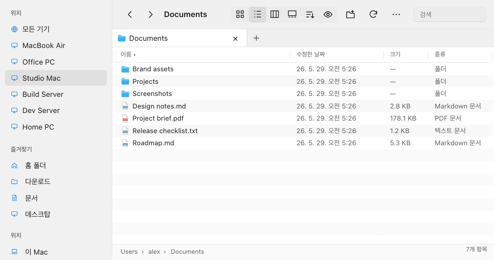
</picture>

**Windows**

<picture>
  <source media="(max-width: 600px) and (prefers-color-scheme: dark)" srcset="docs/img/files-windows-mobile-dark.png">
  <source media="(max-width: 600px)" srcset="docs/img/files-windows-mobile-light.png">
  <source media="(prefers-color-scheme: dark)" srcset="docs/img/files-windows-dark.png">
  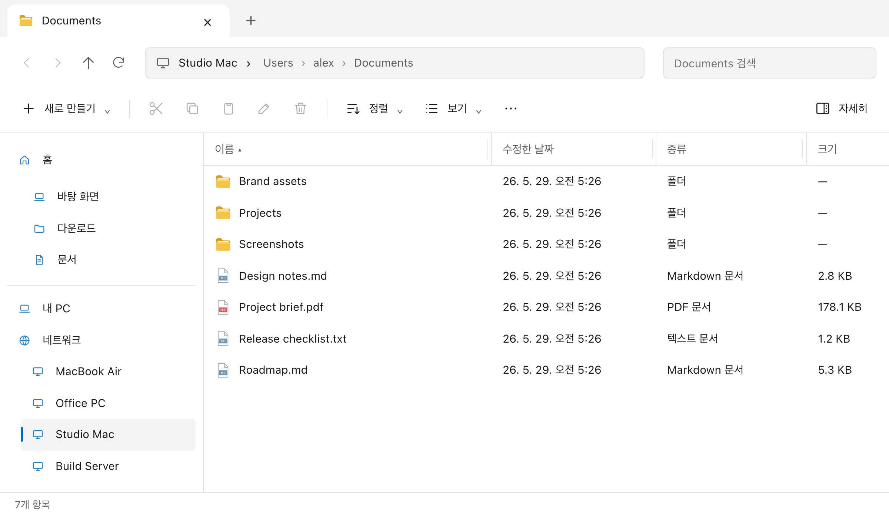
</picture>

The macOS file window uses a single command bar, a resizable sidebar, a bottom path bar, and a compact list with resizable Name/Date/Size/Kind columns and file-type icons. Column view keeps the ancestor columns visible while folders load or are empty. Use Command+1/2/3/4 for icon/list/column/gallery views, Command+[/] for history, Command+Shift+G to go to a folder, and Command+Shift+. to show hidden files. Folder tabs support Command+T/W and Control+Tab; each tab keeps its path, history, selection and view. The preview panel and Space quick preview display bounded text, images, the first PDF page on macOS, and browser-supported audio/video without opening an external app (text up to 512 KiB, media up to 16 MiB). Unsupported formats show metadata and an explicit Open action. HTML/SVG are never rendered as active content. Pointer drag suppresses browser text selection and supports folders, favorites and folder tabs as destinations. The action popover keeps transfer history, split view and connection settings available without an extra command bar.

<details>
<summary>Column and gallery views</summary>

<picture>
  <source media="(prefers-color-scheme: dark)" srcset="docs/img/files-columns-dark.png">
  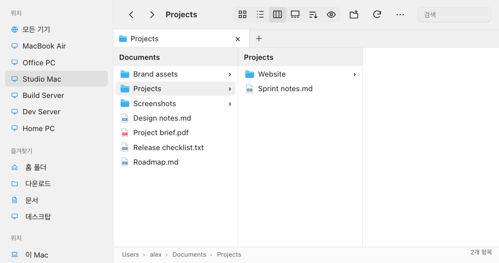
</picture>

<picture>
  <source media="(prefers-color-scheme: dark)" srcset="docs/img/files-gallery-dark.png">
  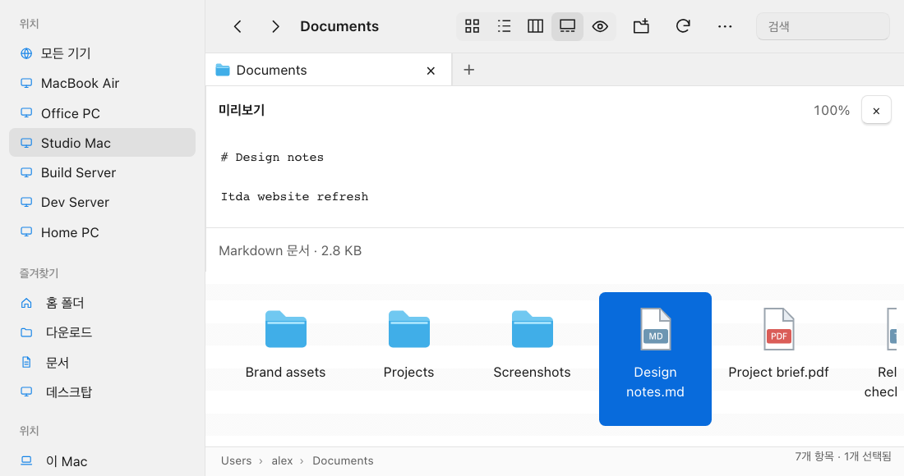
</picture>

</details>

Files inherit the device account by default. Selecting another saved account for files leaves the screen account unchanged. Transport settings are collapsed under connection settings. Auto mode opens a configured SMB share, otherwise attempts SFTP; unavailable SSH can hand off to Finder/Explorer when an SMB service is reachable. Authentication failures require correcting the account. SMB authentication belongs to the OS and may still require its own login prompt.

- **SSH/SFTP:** browse a Mac with Remote Login, Linux/OpenSSH or Windows OpenSSH server. Reuse a saved account/key, or store a separate file password in the OS credential vault.
- **SMB:** open `smb://server/share` or a UNC share in the actual Finder/File Explorer. The remote device must enable file sharing and grant access. LAN and Tailscale addresses work independently of VNC/RDP ports.
- The SFTP workspace follows the local OS style and provides list/icon views, search, sorting, multiselection, history, parent navigation, folders, rename, copy/cut/paste, split-pane drag transfers, and native incoming file drops. Conflicts offer keep both, replace changed files, or skip. Identical-file detection uses size and modification time (SFTP v3 timestamps have one-second precision).
- Writes stage to a temporary destination before renaming. Cross-device moves verify SHA-256 and recheck source metadata before removing it. Same-filesystem moves try rename first. Jobs can be cancelled without removing untransferred sources or replacing existing destinations with partial files.
- **Archive** moves entries into `.itda-trash` within the file connection, not the system Trash/Recycle Bin. Rename/archive support Undo. Opening a remote file creates a local **read-only preview copy**; edits are not uploaded automatically. Only supported document/media formats open directly; other types must first be copied locally. Preview downloads carry the operating system download marker. Ordinary Unix rwx permissions are retained for SFTP copies where supported, without special permission bits; existing merged directory permissions are kept.

**Delta copies:** Auto mode probes local/remote rsync and a compatible remote shell for replace-mode folder copies or files of at least 8MiB. It uses rsync over SSH when available and SFTP otherwise. Windows local rsync must include a compatible `cygpath.exe`. Normal mode never runs rsync. Rsync partial files remain in `.itda-partial` for reuse; SFTP block deltas and partial-file resume are not implemented. No default copy uses mirror/delete semantics.

Browsing and transfers have separate SSH connections. At most two transfer jobs run concurrently; each pipelines up to 64 SFTP requests of 32KiB. Ordinary SFTP copy reports unsupported symlinks instead of following them. Inline folder disclosure, full ACL/xattr preservation, rclone/WebDAV, and an Itda-to-Itda file server remain follow-up work; the workspace does not claim complete Finder/Explorer feature parity. Windows outbound drag is implemented with streamed virtual files and copy-only semantics; native Explorer drop acceptance still needs runtime validation.

## Multiple monitors

Open the viewer's **Monitor** menu to select a display, see the whole desktop, or open one window per display. The default is one remembered display (the first when none is saved). Connection → Display remembers this mode, the preferred monitor, manual layout and whether separated windows should open full screen on local monitors. Extra windows share the connection and decoder; they do not create another remote login. Closing an extra view leaves the others connected; closing the owner hides it while other views remain, and closing the last view ends the session.

The menu shows the server's screen positions and sizes. Itda's Windows sharing server now reports each monitor, including displays left/above the desktop origin. If a server omits topology, the UI shows one desktop and offers explicit horizontal/vertical/2×2 **manual regions**. These are not detected physical monitors. RDP currently exposes one virtual session desktop, not the remote PC's physical displays. Automatic resolution changes stop for multiple display/region views so selecting a window cannot collapse the remote layout.

macOS sibling views draw the same decoded canvas directly; Windows views share the native framebuffer. Neither duplicates the network stream. Remote topology and reordered/removed monitors are matched by stable IDs. Native macOS split windows, pointer/keyboard routing and three quit sequences were checked with a synthetic two-monitor server; Windows unit tests/build run in CI, but the Windows multiple-monitor GUI still needs hardware runtime validation. Dragging between separate monitor windows is not continued across their boundary.

The macOS quit path releases all WebViews and containing windows before Objective-C thread-local teardown, fixing an exit crash found during split-window testing.

## 🖼️ Screenshots

### Nearby devices

Bonjour and Tailscale devices can be added from the same page.

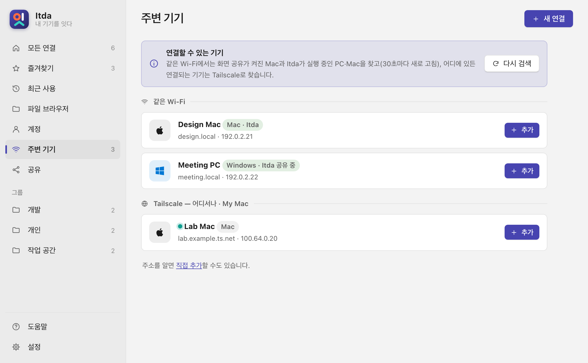

### Open from your phone

Turn on the web viewer, scan its QR code and enter the PIN.

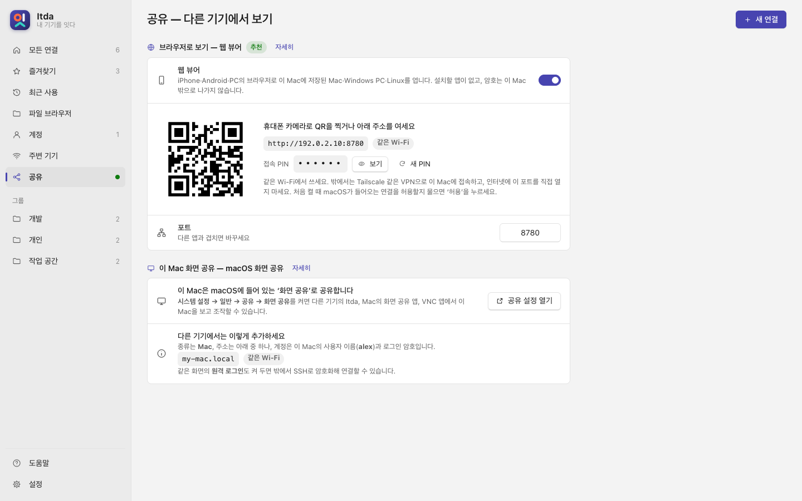

<p align="center">
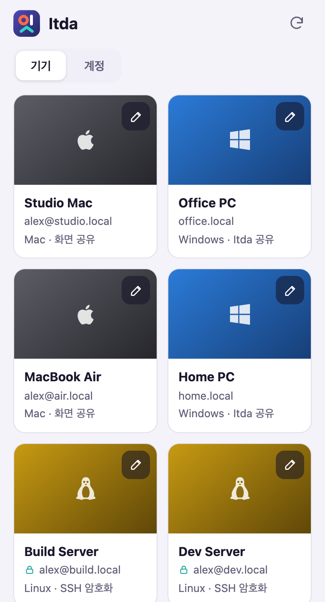
</p>

<details>
<summary>Connection editor and saved accounts</summary>

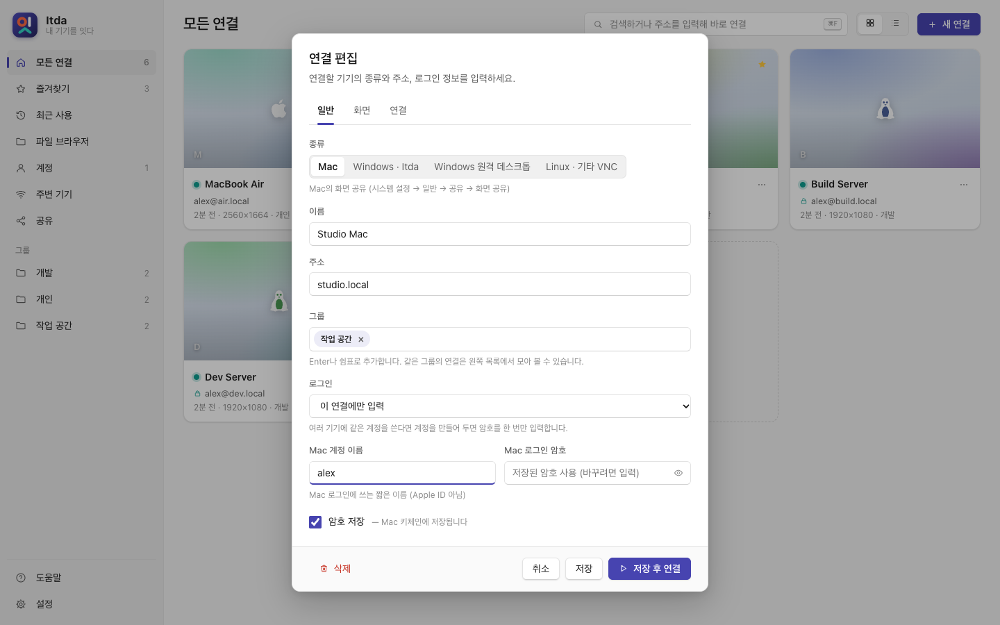

<picture>
  <source media="(prefers-color-scheme: dark)" srcset="docs/img/accounts-dark.png">
  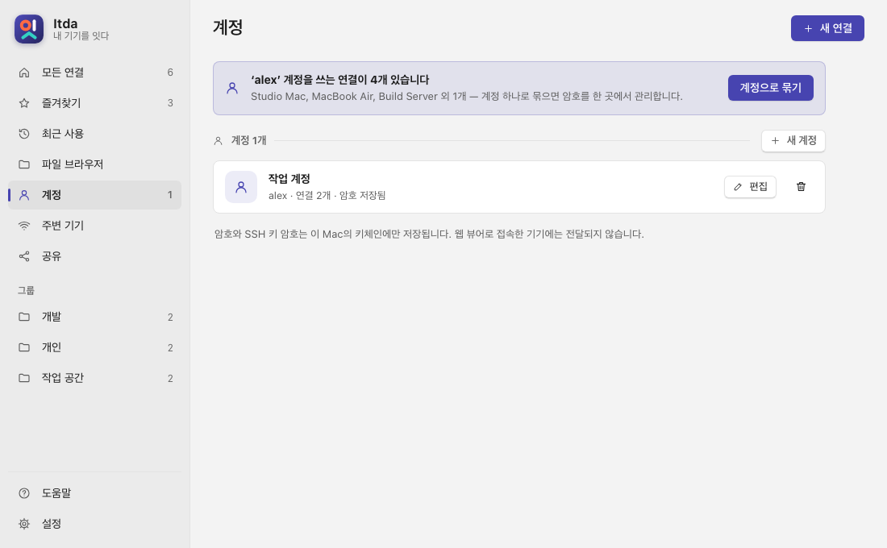
</picture>

</details>

## 🧩 How it works

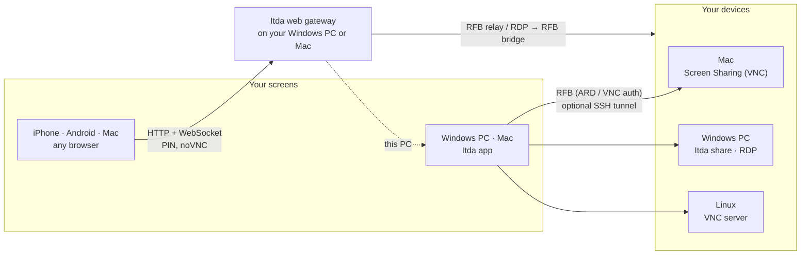

The browser never gets a password. Itda on your PC or Mac signs in to each device and relays only the screen and input.

## 📖 Guide

<details>
<summary><b>Address book, connecting, and the session window</b></summary>

| Screen | What's there |
|---|---|
| Address book | Cards or a list, a preview of the last screen, online ●, favorites ★, groups, search. Type an address and press Enter to connect right away. |
| Nearby | Bonjour (mDNS): Macs with Screen Sharing and every PC or Mac running Itda, even with sharing off (it says how to turn it on); refreshed every 30 s. Plus your Tailscale devices. Add one with a single click. |
| Connecting | Shows each step (address → connect → sign in → screen). You can cancel, or leave it running in the background. |
| Errors | Explains the cause and what to do, worded for the kind of device: Mac, PC, RDP or Linux. |
| Settings | Theme, **display size (Ctrl +/− and Ctrl+wheel; ⌘ on Mac)**, defaults, notifications and previews. Windows also has native session toolbar/hotkey and tray settings. |

**Windows native session toolbar** (top center, auto-hides): fullscreen, fit or 1:1, pick a display, Mac special keys, clipboard, view-only, screenshot (`Pictures\Itda`), stats, pin, disconnect.

**Windows native session hotkeys** (Ctrl+Alt, or Ctrl+Shift): `Enter` fullscreen · `0` fit · `1` 1:1 · `S` stats · `V` view-only · `P` screenshot · `I` info · `T` pin toolbar · `R` reconnect · `M` menu.

The FPS/Mbps/RTT statistics overlay and the shortcuts above belong to the Windows native VNC session. Mac app and browser viewers use the control bar and shortcut menus described in their sections; they do not provide the same statistics overlay.

**Windows keyboard → remote Mac mapping:**

| Windows | Mac |
|---|---|
| Win | ⌘ Command (captured while the window is focused) |
| Alt | ⌥ Option |
| Ctrl | ⌃ Control (or ⌘, with the Ctrl↔Cmd swap) |
| 한/영 | Ctrl+Space or Caps Lock |

If the network drops, the session dims and **reconnects automatically**. Options you change during a session are saved for that connection.

**Windows command line** (these address and `-u`/`-p` options are not the Mac app CLI):

- `itda <address>` opens the home and connects.
- `itda <address> -u <user> -p <password>` connects directly. A `-p` password can appear in the process list and shell history; prefer a saved login in the app.
</details>

<details>
<summary><b>Web viewer: phones, tablets, and Macs</b></summary>

Open **공유** in the sidebar → **웹 뷰어** (or **모두 켜기**). Open the address or scan the QR code on any device, then enter the **6-digit PIN**.

- **What it opens:**
  - Macs and other VNC servers
  - Windows PCs over Remote Desktop (the PC's Itda speaks RDP)
  - **This PC**, when "Share this PC" is on. There's no allow prompt, because the PIN already proved who you are.
- **Manage from the browser:** add, edit and delete devices, and manage accounts. Changes are saved on the PC right away.
- **Touch:**
  - tap = click, two-finger tap = right-click, drag = scroll
  - the phone keyboard (Korean works)
  - modifier latches: ⌘⌥⌃⇧ for Macs, Ctrl/Alt/⇧/⊞ for PCs
  - shortcut sheets: Mac, or Windows (Ctrl+Alt+Del, Alt+Tab, …)
  - clipboard, fit/1:1, view-only
- **Install as an app:**
  - iPhone: Safari → Share → **Add to Home Screen**
  - Mac: Safari → **File → Add to Dock**
  - Chrome/Edge/Android: **Install app**. This needs the `https://…ts.net` Tailscale address.
- **Security:**
  - HttpOnly cookie for 12 hours
  - 5 wrong PINs pause new sign-ins for 1 minute across all clients; existing sessions still work
  - same-origin checks
  - a new PIN signs everyone out
  - The browser ↔ PC leg is plain HTTP, so use it on your own Wi-Fi or over Tailscale and **never forward the port to the internet**.
</details>

<details>
<summary><b>Encryption (SSH), Tailscale, and accounts</b></summary>

**SSH tunnel.** Turn on *SSH로 암호화해서 연결* in the connection editor. It needs the Mac's **Remote Login** (or any SSH server).
- Itda runs Windows' built-in OpenSSH or `/usr/bin/ssh` on Mac without a window, forwarding `127.0.0.1:<random> → device:5900`.
- The password comes from Itda through `SSH_ASKPASS`, and your `~/.ssh` keys and config still work.
- Host keys are stored in the Itda data directory's `known_hosts` (`%APPDATA%\Itda` on Windows; `~/Library/Application Support/Itda` on Mac). If a key changes, the connection stops with a warning.
- The tunnel reopens on its own after a network drop.

**Tailscale.** Your tailnet's Macs, PCs and Linux machines appear under *Nearby → Tailscale*. The web viewer shows a `http://<pc>.<tailnet>.ts.net:8780/` QR code. Turn on HTTPS certificates in the Tailscale admin and press *HTTPS 주소 만들기* to get `https://<pc>.<tailnet>.ts.net/` through `tailscale serve`.

**Accounts.** Save a login once (name, password, optional SSH key and passphrase) and pick it on each device. If several devices share a user name, Itda offers to group them into one account.
</details>

<details>
<summary><b>Windows PCs: Share this PC and Remote Desktop</b></summary>

| Method | Works on | How |
|---|---|---|
| **Share this PC** | Any Windows 10/11 with Itda | On that PC: **공유 → 이 PC 공유**. It shows up as "Windows · Itda" under Nearby; connect with the share password. macOS Screen Sharing and other VNC apps can connect too. |
| **Remote Desktop** | Windows Pro / Enterprise / Education | Choose *Windows 원격 데스크톱* in the editor. Windows Itda opens `mstsc`. The Mac app and web viewer use the built-in IronRDP bridge (TLS + NLA) to show the session. |

**How Share this PC works:**
- Desktop Duplication capture with GDI fallback, 64×64 tile diff, ZRLE
- SendInput for the mouse and keyboard; a Mac's ⌘ acts as Ctrl
- clipboard in both directions
- a random VNC password plus optional approval (enabled by default). Nearby trust is also on by default: private/link-local/ULA and `100.64.0.0/10` addresses skip approval after the password succeeds. These ranges do not establish device ownership; turn off **공유 → 내 기기는 묻지 않기** to require approval
- notifications and a tray badge while someone is watching, and a button that disconnects everyone
- view-only mode and Bonjour registration

Windows security doesn't let a remote viewer control the lock screen, UAC prompts or elevated windows.
</details>

<details>
<summary><b>Your data</b></summary>

| Where | What |
|---|---|
| `%APPDATA%\Itda\hosts.json`, `accounts.json`, `settings.json` (Mac: `~/Library/Application Support/Itda/`) | Address book, accounts, settings |
| `%APPDATA%\Itda\thumbs\` | Small previews of the last screen (can be turned off) |
| Windows Credential Manager `Itda/…` (Mac: login Keychain, service `Itda`) | Passwords, key passphrases, the web PIN, the share password |
| Windows: `%TEMP%\itda.log`, `%TEMP%\itda\session-*.log`; Mac: `$TMPDIR/itda.log` | Diagnostic logs; review device names, addresses and paths before sharing |
</details>

## 🛠️ Build from source

```powershell
cargo build --release      # → target\release\itda.exe
cargo test --release
```

Release builds go through `scripts/windows-release.ps1` (Windows) and `scripts/macos-bundle.sh universal` (Mac → `dist/Itda-macos-universal.zip`). Both keep the build machine's paths out of the binary.

Run `cargo test files::` for file operation tests. On macOS, after `cargo build`, run `node scripts/files-e2e.mjs` with Playwright installed for UI and transfer integration tests against a temporary SSH server. The fixture does not change system SSH settings or user files.

<details>
<summary><b>Project layout</b></summary>

| File | Role |
|---|---|
| `home.rs` · `home_win.rs` · `home_mac.rs` | Home window and page IPC, sessions, reachability; per platform: WebView2 + tray + session processes (Windows), WKWebView + menu bar + viewer windows (macOS) |
| `web/` | Home UI (HTML/CSS/JS, embedded; `ITDA_WEB_DIR` serves it from disk) |
| `session.rs` · `ui.rs` · `toolbar.rs` | Windows native session process and window: rendering, input, toolbar, reconnect, screenshots |
| `rfb.rs` · `net.rs` · `fb.rs` · `clip.rs` | RFB handshake/auth, receive loop and reconnect, decoders, clipboard |
| `tunnel.rs` | SSH tunnel through system OpenSSH (Windows and Mac) |
| `gateway.rs` · `ws.rs` · `web/viewer/` | Web viewer: HTTP/WebSocket, PIN, address-book API, RFB relay, PWA |
| `rdp.rs` | RDP → RFB bridge (IronRDP, TLS + NLA → framebuffer → ZRLE) |
| `share.rs` | Share this PC: Windows VNC server (Desktop Duplication with GDI fallback, tile diff, ZRLE, SendInput, Bonjour) |
| `enc.rs` | RFB pixel formats and Raw/ZRLE rectangles (shared by `share.rs` and `rdp.rs`) |
| `web/icons.js` · `scripts/macos-bundle.sh` | Itda for Mac: stroke icons in place of Segoe Fluent glyphs, `.app` bundle |
| `store.rs` · `mdns.rs` · `tailscale.rs` | Storage and credentials, Bonjour, Tailscale CLI |

| Area | Implementation |
|---|---|
| Protocol | RFB 3.8 (macOS 3.889). Auth: None, VNC (DES), Apple ARD (DH + AES-128) |
| Encodings | ZRLE, CopyRect, Raw, plus Cursor, DesktopSize, ExtendedDesktopSize and Extended Clipboard |
| Latency | TCP_NODELAY, pipelined update requests, local cursor, liveness probes |
| Windows native rendering | DIB section, dirty-rect blits, `BitBlt` at 1:1 / `StretchBlt(HALFTONE)` when scaled, per-monitor DPI v2 |

Test hooks `ITDA_TEST_HTTP`, `ITDA_TEST_SNAP` and `ITDA_DEBUG_PORT` do nothing unless those environment variables are set.
</details>

## 🗺️ Roadmap

- [ ] Relay for reaching devices without a VPN
- [x] Native Mac app (Itda for Mac)
- [ ] Native Linux app (for now, use the web viewer)
- [ ] RDP in the browser: clipboard, audio, drives, RD Gateway
- [x] In-app updates with confirmation
- [x] Developer ID signing and notarization for Mac releases
- [ ] Signed Windows installer

## 🤝 Contributing & security

Issues and PRs are welcome; see [CONTRIBUTING.md](CONTRIBUTING.md). Report vulnerabilities privately as described in [SECURITY.md](SECURITY.md).

## 📜 License & credits

[MIT](LICENSE) © 2026 Jiun Bae.

Itda builds on:
- [noVNC](https://github.com/novnc/noVNC) 1.7.0 (MPL-2.0, bundled in `web/viewer/novnc.min.js` with a faster ZRLE decoder; see `web/viewer/NOVNC.md`)
- [IronRDP](https://github.com/Devolutions/IronRDP) (MIT/Apache-2.0) and [rustls](https://github.com/rustls/rustls)
- [wry](https://github.com/tauri-apps/wry) and the Rust crates in `Cargo.toml`

<sub>The icon draws the letters of 잇: ㅇ is your device, ㅣ the link, and ㅅ the bridge to your other machines. Each stroke has its own colour for each platform Itda connects.</sub>
